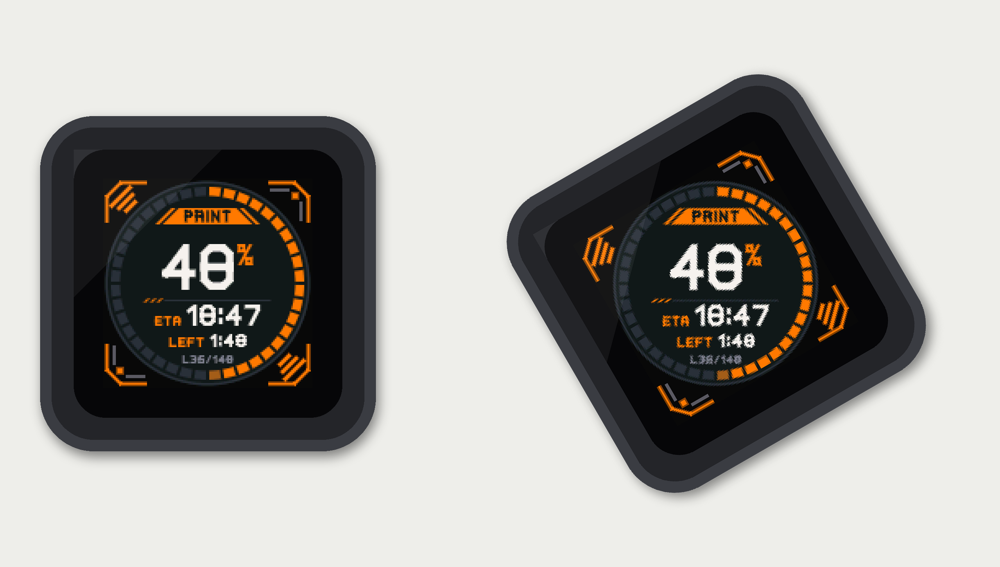
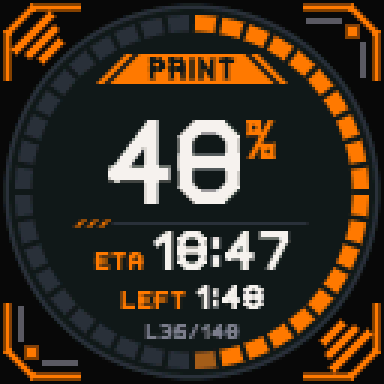
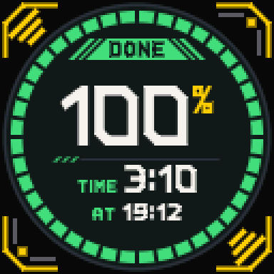
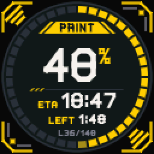

# CrealityHiMonitor — HM-01

A live print monitor for the **Creality Hi**, on an **M5Stack AtomS3R**. The 24 mm cube sits next to the printer and shows the job's **percent done**, the **time left** and the **finish time (ETA)**. When the job ends it **alerts**: the screen flashes, and it plays a chime if a speaker is fitted. The display is a mech-style HUD that **turns with the cube**: stand it on any side or tilt it, and the dial rotates smoothly to stay upright.



> **Status: v0.1.0, first release.**
> - The firmware's logic passes 28 unit tests on the host.
> - The parser and the ETA are checked against a real 2.5 h print on a Creality Hi, replayed in the tests.
> - On an AtomS3R it boots, reads the IMU and answers the console. The tilt angle matched claude-monitor's in the same position.
> - **The live link works on hardware:** setup from a phone, Wi-Fi join, printer search, and steady data from a Creality Hi mid-print (fixes in [Unreleased](CHANGELOG.md)).
> - **Not yet checked on hardware:** the end-of-job alert.
> - Every image here is rendered by the firmware's own drawing code.

## What it shows

| Printing | Paused | Done |
|---|---|---|
|  |  |  |

**Printing screen:**

- **48 %**: the share of the job's estimated print time already printed, not the position in the file.
- **ETA 18:47**: the wall-clock time the job should end, on the big line.
- **LEFT 1:48**: hours:minutes still to print. See [How the ETA is computed](#how-the-eta-is-computed).
- **Ring**: 40 segments, one per 2.5 %. The next segment blinks while printing.
- **L36/148**: current layer / total layers.
- **Title band**: PRINT, HEAT (heating and levelling before the first layer), PAUSED, DONE, STOP or ERROR, in its own colour.

When the job ends, the DONE / STOP / ERROR screen stays for 30 minutes with the total print time and the time it ended. The printer itself only says "complete" for about a minute. A finished job also raises an [alert](#alerts).

| Idle | Boot | Setup |
|---|---|---|
|  |  |  |

- **READY** (no job): a clock, nozzle (N) and bed (B) temperatures, and the printer's name.
- **Boot**: the HM-01 title card.
- **Setup**: the Wi-Fi setup portal is open, with the network name and password to use.
- **Link / Offline**: Wi-Fi, the search for the printer, the connection to it.

All screens are on [one sheet](docs/img/screens.png). The boot image at panel size (128 × 128) is [`docs/img/splash.png`](docs/img/splash.png).

## Smooth auto-rotation



HM-01 follows claude-monitor's AtomS3R pattern:

- **Gravity, not the gyro.** The accelerometer gives the direction of gravity.
- **Smoothed.** A low-pass filter (~130 ms at 30 fps) turns the HUD towards it.
- **Redrawn only when needed.** A new frame is drawn once the angle has moved a degree.
- **Held when flat.** Lying flat on the desk, the cube keeps the last angle.

**Why the HUD stays sharp at any angle:**

- Everything that matters lives inside the round dial. Only the bezel's corner markings are fixed to the panel.
- The dial is drawn as vectors: anti-aliased polygons, arcs and the house mech stroke font.
- Turning it means turning the vertices and drawing again, not rotating a bitmap. Text stays sharp at 37° as well as at 90°.

## Mech look

Same house style as the printed parts of the other projects (Tab5 stand, OutageAlarm, FilamentDryer, CrealityHiDrawer):

- straight lines and 45° cuts;
- a title band with the label knocked out and hazard stripes;
- corner brackets, speed dashes, reticles;
- the chamfered stroke font, here drawn on screen instead of inlaid in plastic.

Orange livery on graphite, with a colour per state: orange printing, amber paused, green done, red stopped or failed, cyan for network screens.

## Hardware

| Part | Notes |
|---|---|
| **M5Stack AtomS3R** (ESP32-S3, 0.85" 128 × 128 IPS, BMI270 IMU, button under the screen) | the whole device |
| USB-C cable and any 5 V USB supply | power |
| Optional: **M5Stack Atomic Echo Base** (speaker), or a **piezo buzzer** on the Grove port | sound for the [alerts](#alerts); the AtomS3R has no speaker |

The printer and the AtomS3R must be on the same network. HM-01 reads one stock interface of the printer, the **Creality websocket on port 9999**: the one Creality Print uses. It gives the state, times, layers, temperatures and errors. No root, no printer settings to change. Protocol notes: [docs/creality-websocket.md](docs/creality-websocket.md).

## Install

### Prebuilt binary

Every CI run builds the firmware: open the latest green run of the **Firmware** workflow in the [Actions tab](https://github.com/icefoxj/CrealityHiMonitor/actions) and download the `CrealityHiMonitor-firmware` artifact. Tagged versions also go to [Releases](https://github.com/icefoxj/CrealityHiMonitor/releases). Write `CrealityHiMonitor-atoms3r-merged.bin` at `0x0`:

```bash
pip install esptool
esptool.py --chip esp32s3 write_flash 0x0 CrealityHiMonitor-atoms3r-merged.bin
```

If the port is not found, hold the AtomS3R's reset button until the green LED lights, to enter download mode. Then run the command again.

### From source

```bash
cd firmware
pio run -e atoms3r -t upload     # PlatformIO
pio device monitor               # serial console, 115200
```

## Setup

1. **Power it.** On first boot the screen shows **SETUP**, a network name `HM-01-xxxx` and its password.
2. **Join that network** with a phone. The setup page opens by itself; if it does not, browse to `http://192.168.4.1`.
3. **Choose your Wi-Fi** and save. HM-01 joins it and closes the portal.
   - Pick a **2.4 GHz** network: the ESP32-S3 has no 5 or 6 GHz radio. If a WPA3-only network refuses it, use a WPA2 one.
   - It must reach the printer: the same network as the Hi is simplest.
4. **Wait for the printer.** HM-01 searches its subnet (the /24) for a Creality printer on port 9999 and remembers the address. If the printer later moves to another address, it searches again.

From then on HM-01 needs only power: any 5 V USB supply. It talks to the printer by itself, with no PC and no app in between, and keeps its settings through power cuts.

On the portal's **Setup** page:

- **Printer address**: set it there to skip the search (blank = search).
- **Time zone**: a POSIX TZ string for the clock and the ETA. The default is Lisbon/London, `WET0WEST,M3.5.0/1,M10.5.0`. Examples: `CET-1CEST,M3.5.0,M10.5.0/3` (central Europe), `<-03>3` (São Paulo), `EST5EDT,M3.2.0,M11.1.0` (New York).

**Button** (the screen itself):

| Press | Effect |
|---|---|
| Click | Silences an alert. Otherwise: on a DONE / STOP / ERROR screen, the first click dismisses it; then brightness: bright → dim → off → bright |
| Hold 3 s | Open the setup portal again (Wi-Fi, printer, time zone) |

The READY screen dims by itself after 15 minutes.

## Serial console

Any serial terminal at 115200 baud on the USB port (`pio device monitor`):

| Command | Effect |
|---|---|
| `status` | one line with the link, the printer's raw numbers, the estimate, the tilt angle and the IMU reading |
| `printer <ip>` / `printer auto` | set the printer address / search again |
| `tz <POSIX TZ>` | time zone |
| `calibrate rot=<0-3> sign=<1\|-1> offset=<deg>` / `calibrate reset` | orientation, saved |
| `bright <0-255>` | backlight level, saved |
| `sound on\|off`, `volume <0-255>` | alert sound, saved |
| `buzzer <gpio>` / `buzzer off` | piezo buzzer pin when there is no Echo Base, saved |
| `beep` | play the "job done" chime (a speaker test) |
| `setup` | open the setup portal |
| `wifi reset` | forget the Wi-Fi network and reboot into setup |
| `version`, `reboot`, `help` | |

## Orientation

The defaults are the ones claude-monitor verified on an AtomS3R, with the same M5Unified IMU mapping:

- display rotation = the board default + 1;
- tilt sign −1, offset 0°.

If the dial is not upright on yours, calibrate it from the console:

1. **Fix the base orientation.** Stand the cube with the USB port down and run `calibrate rot=N` (N = 0, 1, 2 or 3). Pick the N that shows the HUD upright.
2. **Fix the direction.** Turn the cube a quarter. If the HUD turns away from upright instead of staying upright, run `calibrate sign=1`.
3. **Fix a constant tilt.** If the HUD is upright but tilted by a fixed angle, set `calibrate offset=<deg>`.

`status` reports `angle=`, the angle in use, and the raw `ax/ay/az`. `calibrate reset` returns to the defaults.

## Alerts

| Event | Screen | Sound (if a speaker is fitted) |
|---|---|---|
| Job **done** | the DONE screen flashes for 90 s at full brightness, even if the screen was dimmed or off | a chime, three times, 30 s apart |
| Printer **stopped on an error**, or **paused itself** with an error code (e.g. filament run-out) | the screen flashes while it lasts, up to 5 min | an alarm every 30 s, up to 5 min |
| Job cancelled (STOP) | no alert: you did it | none |

A click on the button silences an alert.

**Sound.** The AtomS3R has no speaker. HM-01 plays the alerts on either:

- an **Atomic Echo Base** stacked under the Atom: found automatically at boot (its codec answers on I2C);
- a **piezo buzzer** on a free pin. Wire it to the Grove port, signal on G2 (yellow) or G1 (white), and run `buzzer 2` (or `buzzer 1`) once on the console. G5–G8, G38 and G39 on the bottom header work too.

`beep` plays the chime to check it; `sound off` mutes; `volume <0-255>` sets the level.

## How the ETA is computed

The printer offers two numbers. HM-01 logged both, every 30 s, over a 2 h 31 min print and compared them with the real end:

| Source | What it is | How it did |
|---|---|---|
| `printLeftTime` | Creality's estimated total time minus the time printed: a countdown | the job ended **163 s after** the estimate (1.8 %) |
| print time ÷ estimated total | share of the estimated time already printed | within ~1.5 points of the real share all along |
| `printProgress` | position in the G-code file | **16 % at 43 % of the time**: wide bottom layers hold few bytes per minute |
| Moonraker's M73 progress | the slicer's percent from the G-code | **78 % when the job ended**: not usable |

**HM-01's estimate:**

- **Percent** = print time ÷ the estimated total (capped at 99 % until the printer says it is done).
- **LEFT** = the printer's countdown.
- **Past the estimate** (countdown at 0, still printing): the rest comes from the file position, which is accurate near the end of the file.
- **ETA** = now + LEFT.
- **While paused**, the numbers are held.

The real print is replayed in the unit tests. Details: [docs/creality-websocket.md](docs/creality-websocket.md).

## Development

```bash
cd firmware
pio test -e native          # 28 unit tests on the host (needs gcc)
pio run -e atoms3r          # firmware

# Screens -> docs/img (needs g++ and Pillow). Same drawing code as the device.
python tools/previews.py
```

```
firmware/
  src/                 hardware glue: main.cpp (display, IMU, button, console), net.cpp (Wi-Fi portal,
                       printer search, websocket), sound.cpp (Echo Base / buzzer), settings.cpp (NVS), config.h
  lib/hm_core/src/     plain C++, tested on the host:
    printer.*          Creality websocket parsing, state codes
    eta.*              percent and time-left estimate
    alert.*            end-of-job / attention alerts, melodies
    job.*              printer state -> screen, end-of-job latch
    screens.*          the bezel and the HUD screens
    gfx.*              anti-aliased vector drawing into an RGB565 buffer
    mechfont.*         the mech stroke font
    tilt.*             accelerometer -> smoothed HUD angle (from claude-monitor)
    console.*          serial command parser
  test/test_core/      Unity tests
tools/                 preview.cpp (host renderer), previews.py (docs images)
docs/                  protocol notes, images
```

CI (`.github/workflows/firmware.yml`) runs the tests and builds the firmware on every push. A `vX.Y.Z` tag publishes a release with the binaries (`release.yml`).

## Known limitations

- The setup portal and the printer interfaces have no authentication: keep HM-01 and the printer on a trusted network.
- The printer search covers the /24 around the AtomS3R's own address. On other networks, set the address.
- Only the Creality Hi has been tested. Other Creality printers with the same websocket (K1, K1C, K1 Max, K2) should work.
- The ETA is only as good as Creality's time estimate: it was within 2 % on the measured print. A printer that runs much slower than the estimate shows 99 % and the file-based tail at the end.

## License

[MIT](LICENSE). The tilt filter and the orientation defaults come from claude-monitor, by the same author.
