# CrealityHiMonitor — HM-01

A live print monitor for the **Creality Hi**, in three builds:

- **M5Stack AtomS3R**: the 24 mm cube sits next to the printer and shows the job's **percent done**, the **time left** and the **finish time (ETA)**. The display is a mech-style HUD that **turns with the cube**: stand it on any side or tilt it, and the dial rotates smoothly to stay upright.
- **M5Stack CoreS3**: a 320 × 240 [desk dashboard](#m5stack-cores3-dashboard) in the same livery, with **everything the printer reports** about the job: times, layer, Z, temperatures and targets, speed, flow, fans, filament used, the file, the material and the slicer's estimate.
- **M5Stack CardputerZero**: an [app in its launcher menu](#m5stack-cardputerzero-app) (Linux on a Raspberry Pi CM0), the same dashboard on its 320 × 170 screen, in two pages.

When the job ends it **alerts**: the screen flashes, and it plays a chime if a speaker is fitted (the CoreS3 has one).


> **Status: v0.3.0: the CardputerZero app joins the AtomS3R and CoreS3 builds.**
> - The firmware's logic passes 36 unit tests on the host.
> - The parser and the ETA are checked against a real 2.5 h print on a Creality Hi, replayed in the tests.
> - On an AtomS3R it boots, reads the IMU and answers the console. The tilt angle matched claude-monitor's in the same position.
> - **The live link works on hardware:** setup from a phone, Wi-Fi join, printer search, and steady data from a Creality Hi mid-print.
> - **The alert flash works on hardware**, run from the console (`alert done`).
> - **Not yet seen on hardware:** an alert raised by a real job end, and the alert sounds on the AtomS3R.
> - **CoreS3 build, on hardware:** set up from a phone, it found the Hi and showed the live dashboard mid-print. It reads its battery and draws a frame in 115–180 ms. These all worked on the device: the chime on its own speaker, portrait and upside down, waking on a move, and silencing with a knock.
> - **CardputerZero app, on hardware:** installed with its `.deb`, it shows up in the launcher menu as **Hi Monitor**. It found the Hi on the network by itself and showed the live job. These all worked on the device: both pages, the keys, the battery and the chime on its speaker.
> - Every image here is rendered by the firmware's own drawing code.

## What it shows

| Printing | Paused | Done |
|---|---|---|
|  | 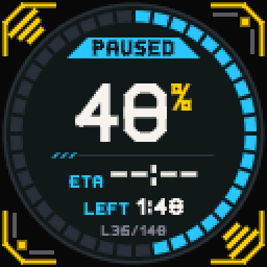 |  |

**Printing screen:**

- **48 %**: the share of the job's estimated print time already printed, not the position in the file.
- **ETA 18:47**: the wall-clock time the job should end, on the big line.
- **LEFT 1:48**: hours:minutes still to print. See [How the ETA is computed](#how-the-eta-is-computed).
- **Ring**: 40 segments, one per 2.5 %. The next segment blinks while printing.
- **L36/148**: current layer / total layers.
- **Title band**: PRINT, HEAT (heating and levelling before the first layer), PAUSED, DONE, STOP or ERROR, in its own colour.

When the job ends, the DONE / STOP / ERROR screen stays for 30 minutes with the total print time and the time it ended. The printer itself only says "complete" for about a minute. A finished job also raises an [alert](#alerts).

| Idle | Boot | Setup |
|---|---|---|
| 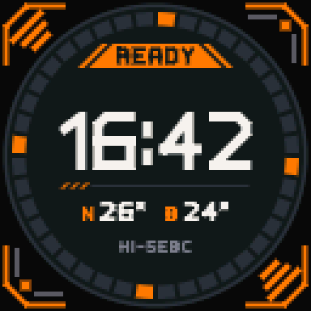 | 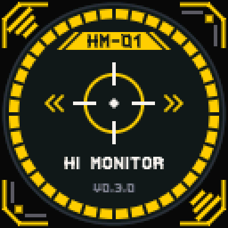 | 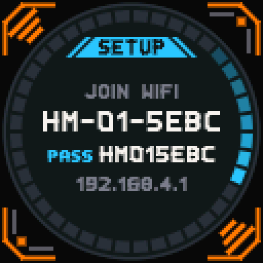 |

- **READY** (no job): a clock, nozzle (N) and bed (B) temperatures, and the printer's name.
- **Boot**: the HM-01 title card.
- **Setup**: the Wi-Fi setup portal is open, with the network name and password to use.
- **Link / Offline**: Wi-Fi, the search for the printer, the connection to it.

All screens are on [one sheet](docs/img/screens.png). The boot image at panel size (128 × 128) is [`docs/img/splash.png`](docs/img/splash.png).

## Smooth auto-rotation


HM-01 follows claude-monitor's AtomS3R pattern:

- **Gravity, not the gyro.** The accelerometer gives the direction of gravity.
- **Smoothed.** A low-pass filter (~130 ms at 30 fps) turns the HUD towards it.
- **Redrawn only when needed.** A new frame is drawn once the angle has moved a degree.
- **Held when flat.** Lying flat on the desk, the cube keeps the last angle.

**Why the HUD stays sharp at any angle:**

- Everything that matters lives inside the round dial. Only the bezel's corner markings are fixed to the panel.
- The dial is drawn as vectors: anti-aliased polygons, arcs and the house mech stroke font.
- Turning it means turning the vertices and drawing again, not rotating a bitmap. Text stays sharp at 37° as well as at 90°.

## M5Stack CoreS3 dashboard

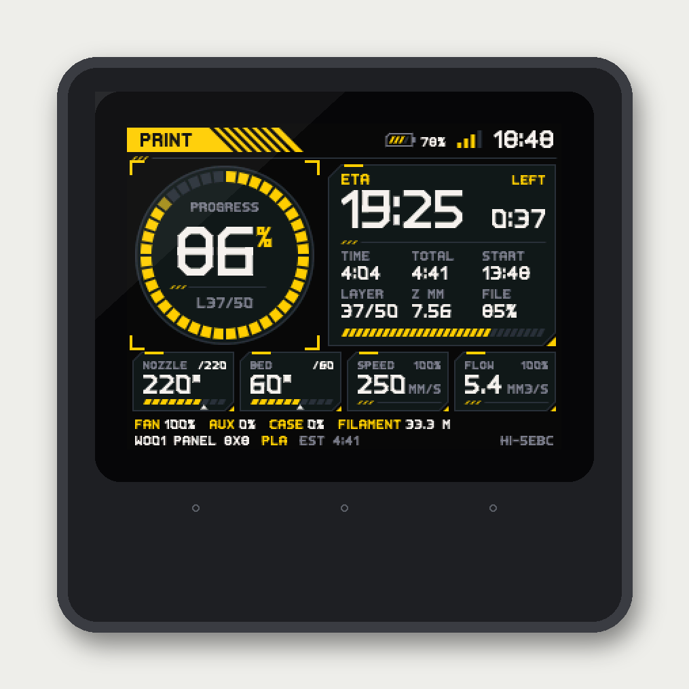

The same firmware, built for the CoreS3 (`pio run -e cores3`), lays the job out on a 320 × 240 dashboard. The screen above shows a real job on the Hi. Percent and ETA stay the largest things on it.

| Part | What it shows |
|---|---|
| **Title band** | the state (PRINT, HEAT, PAUSED, DONE, STOP, ERROR); a code from the printer, if any; the **battery** (%, a bolt while charging, red at 15 % or less; hidden when no battery is fitted); the Wi-Fi signal; the clock |
| **Gauge** | the 40-segment ring and the percent done (the same estimate as the AtomS3R), the layer |
| **Panel** | **ETA** big, **LEFT** time; print **TIME** so far, **TOTAL** (time so far + time left), **START** clock; **LAYER**, **Z** height, **FILE** position %; a layer bar |
| **Tiles** | **NOZZLE** and **BED**: temperature, target (`/220`, or OFF) and a gauge with the target marked; **SPEED** (mm/s) and **FLOW** (mm³/s) in real time, with the speed and flow overrides (%) |
| **Lines** | part, auxiliary and case **fans** (%), **filament** used (m), the chamber temperature on printers that have a sensor; the **job name**, the **material** and the slicer's estimate (**EST**), read from Creality Print's file name; the printer's name |

**Printer codes.** The printer reports a code (`err.errcode`) in its status. Where the job stopped on it (the ERROR screen, a pause), it shows in red as `ERR 2839`. During a normal print it is a notice and shows in grey as `CODE 500`: the Hi reports 500 through whole normal prints, which Creality's error table lists as a prompt from its AI print detection.

When the job ends, the panel turns to the end screen: the time it **ENDED**, the total **TIME**, the **START**, the slicer's estimate, the filament used, the layers, the material and, after a failure, the error **CODE**.

| Printing | Done |
|---|---|
| 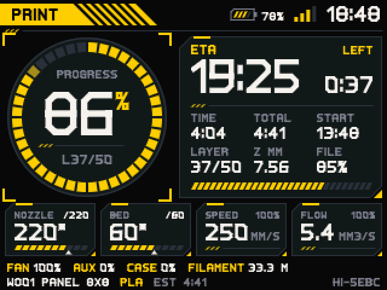 | 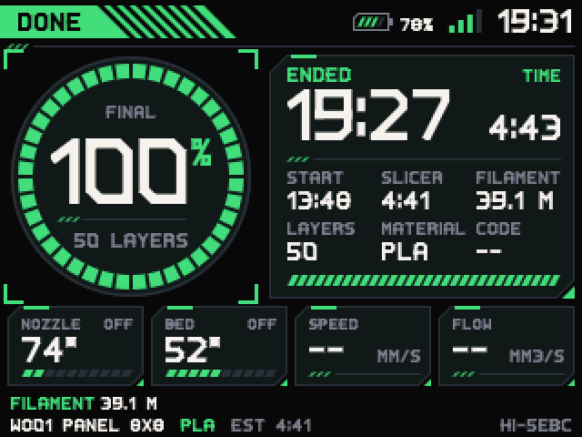 |
| **Ready** | **Setup** |
| 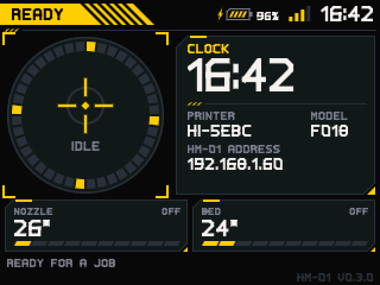 | 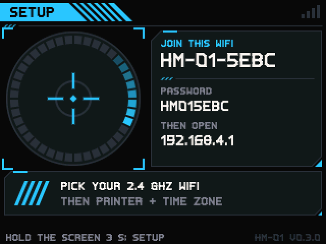 |

All CoreS3 screens are on [one sheet](docs/img/cores3-screens.png).

**It turns with the device.** The CoreS3's accelerometer (BMI270) tells which way is up:

- upside down, the dashboard turns over;
- stood on either side, it switches to a portrait layout with the same data.

| Portrait, printing | Portrait, done |
|---|---|
| 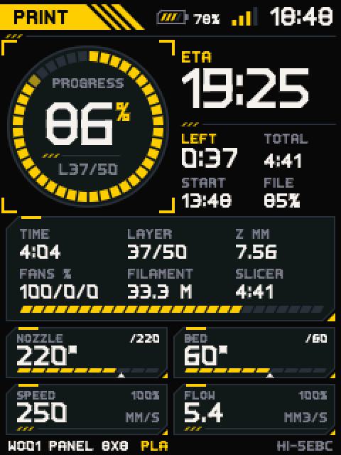 | 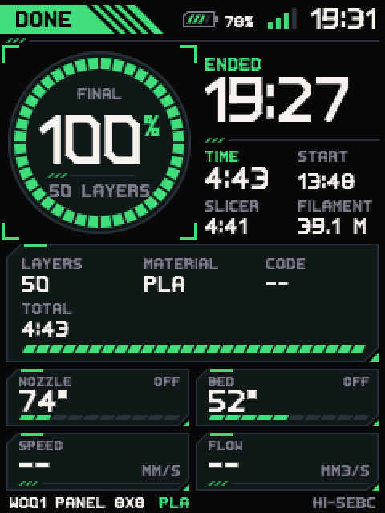 |

It turns only once the device has rested in the new position for about half a second, and it holds while the device lies flat. `autorotate off` keeps it in the normal landscape position. All portrait screens are on [one sheet](docs/img/cores3-portrait-screens.png).

**On the device:**

- **The touch screen is the button:** tap and hold work as on the AtomS3R's button (see [Setup](#setup)).
- **Sound:** the CoreS3 plays the [alerts](#alerts) on its own speaker.
- **A knock on the case silences an alert**, as a tap on the screen does.
- **Moving it wakes it:** when the screen is dimmed or dark, picking the device up or turning it lights it again. The shake of a finger tapping the screen does not count, so tapping still dims it.
- **Redraws:** the frame is drawn in strips from internal RAM, in 115–180 ms. The printer's numbers change several times a second, so the screen shows them at most every 300 ms; a new screen, a turn and an alert's flash are drawn at once.
- **The IMU** is read by its own task, 200 times a second: a knock lasts only a few milliseconds.

## M5Stack CardputerZero app

The CardputerZero is a Linux handheld (Raspberry Pi CM0, Debian, a 320 × 170 screen and a keyboard). HM-01 runs on it as an app in its launcher (APPLaunch): pick **Hi Monitor** in the menu.

| Main page | Details page |
|---|---|
| 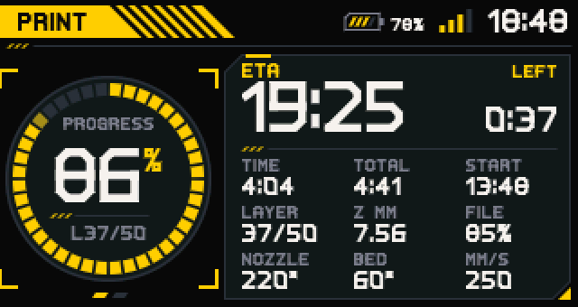 | 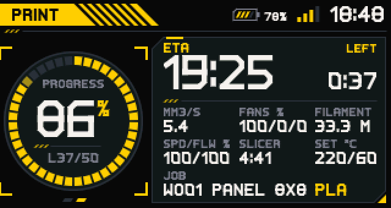 |

- **Both pages** keep the gauge with the percent and the ETA, the largest things on screen, and the time left.
- **Main page:** print time, total, start; layer, Z, file position; nozzle, bed, speed.
- **Details page:** flow, the three fans, filament used, the speed and flow overrides, the slicer's estimate, the heaters' targets (or the chamber), the job's name and material.
- **The title band** shows the state, the printer's code (grey `CODE`, red `ERR`), the CardputerZero's battery, the Wi-Fi signal and the clock.
- **Keys:** `Tab`, the arrows or `,` `.` `;` `/` switch the page; `Enter` or `Space` silence an alert, then dismiss an end screen; `T` tests the alert; `Esc` returns to the menu.
- **The printer** is found on the network by itself and remembered; the CardputerZero's own Wi-Fi is set up by its system. `hm01 --printer <ip>` sets the address, `hm01 --search` forgets it, `hm01 --demo` shows sample data. Over SSH, `hm01 --info` reports the screen, keyboard, battery and Wi-Fi it found, and `hm01 --probe 10` runs the printer link alone and prints what it reads.
- **Alerts** flash the screen and play the chime on its speaker (through `aplay`).

All CardputerZero screens are on [one sheet](docs/img/cardputerzero-screens.png).

**Install:** copy the `.deb` from the [latest release](https://github.com/icefoxj/CrealityHiMonitor/releases/latest) to the device and install it:

```bash
scp hm01-hi-monitor_<ver>_arm64.deb <user>@<cardputerzero>:/tmp/
ssh <user>@<cardputerzero> sudo dpkg -i /tmp/hm01-hi-monitor_<ver>_arm64.deb
```

It puts the program in `/usr/share/APPLaunch/bin/hm01`, its menu entry in `/usr/share/APPLaunch/applications/hm01.desktop` and the icon in `share/images/`. The launcher picks the entry up on its own. `sudo dpkg -r hm01-hi-monitor` removes it.

**Build** (any Linux with an aarch64 cross compiler, or WSL on Windows):

```bash
sudo apt install g++-aarch64-linux-gnu dpkg-dev curl
cardputerzero/build.sh          # -> cardputerzero/build/hm01 and the .deb
```

The binary is static, so it does not depend on the device's glibc. The app uses the same `lib/hm_core` as the firmware (parser, ETA, alerts, the dashboard drawing) and draws straight into the framebuffer. The launcher hands the screen over while an app runs.

## Mech look

Same house style as the printed parts of the other projects (Tab5 stand, OutageAlarm, FilamentDryer, CrealityHiDrawer):

- straight lines and 45° cuts;
- a title band with the label knocked out and hazard stripes;
- corner brackets, speed dashes, reticles;
- the chamfered stroke font, here drawn on screen instead of inlaid in plastic.

Yellow livery on graphite, with a colour per state: yellow printing, cyan paused, green done, red stopped or failed, cyan for network screens.

## Hardware

| Part | Notes |
|---|---|
| **M5Stack AtomS3R** (ESP32-S3, 0.85" 128 × 128 IPS, BMI270 IMU, button under the screen) | the cube with the turning HUD |
| or **M5Stack CoreS3** (ESP32-S3, 2.0" 320 × 240 IPS touch screen, speaker) | the [desk dashboard](#m5stack-cores3-dashboard) |
| or **M5Stack CardputerZero** (Raspberry Pi CM0, Debian, 1.9" 320 × 170 screen, keyboard, speaker, battery) | the [launcher app](#m5stack-cardputerzero-app); it uses the device's own Wi-Fi |
| USB-C cable and any 5 V USB supply | power (the CardputerZero runs on its battery too) |
| Optional, AtomS3R only: **M5Stack Atomic Echo Base** (speaker), or a **piezo buzzer** on the Grove port | sound for the [alerts](#alerts); the AtomS3R has no speaker |

The printer and HM-01 must be on the same network. HM-01 reads one stock interface of the printer, the **Creality websocket on port 9999**: the one Creality Print uses. It gives the state, times, layers, temperatures and errors. No root, no printer settings to change. Protocol notes: [docs/creality-websocket.md](docs/creality-websocket.md).

## Install

### Prebuilt binary

Download the image for your board from the [latest release](https://github.com/icefoxj/CrealityHiMonitor/releases/latest): `CrealityHiMonitor-atoms3r-merged.bin` or `CrealityHiMonitor-cores3-merged.bin`. Builds of the newest `main` are in the `CrealityHiMonitor-firmware` artifact of the latest green **Firmware** run in the [Actions tab](https://github.com/icefoxj/CrealityHiMonitor/actions). Write the merged image at `0x0`:

```bash
pip install esptool
esptool.py --chip esp32s3 write_flash 0x0 CrealityHiMonitor-atoms3r-merged.bin   # or ...-cores3-merged.bin
```

If the port is not found, enter download mode and run the command again. On the AtomS3R, hold the reset button until the green LED lights. On the CoreS3, hold the reset button on its side for about 3 s, until the green LED lights.

**CardputerZero:** the release's `hm01-hi-monitor_<ver>_arm64.deb` installs the app in its launcher; see [M5Stack CardputerZero app](#m5stack-cardputerzero-app).

### From source

```bash
cd firmware
pio run -e atoms3r -t upload     # AtomS3R (PlatformIO)
pio run -e cores3 -t upload      # CoreS3
pio device monitor               # serial console, 115200
```

## Setup

1. **Power it.** On first boot the screen shows **SETUP**, a network name `HM-01-xxxx` and its password.
2. **Join that network** with a phone. The setup page opens by itself; if it does not, browse to `http://192.168.4.1`.
3. **Choose your Wi-Fi** and save. HM-01 joins it and closes the portal.
   - Pick a **2.4 GHz** network: the ESP32-S3 has no 5 or 6 GHz radio. If a WPA3-only network refuses it, use a WPA2 one.
   - It must reach the printer: the same network as the Hi is simplest.
4. **Wait for the printer.** HM-01 searches its subnet (the /24) for a Creality printer on port 9999 and remembers the address. If the printer later moves to another address, it searches again.

From then on HM-01 needs only power: any 5 V USB supply. It talks to the printer by itself, with no PC and no app in between, and keeps its settings through power cuts.

On the portal's **Setup** page:

- **Printer address**: set it there to skip the search (blank = search).
- **Time zone**: a POSIX TZ string for the clock and the ETA. The default is Lisbon/London, `WET0WEST,M3.5.0/1,M10.5.0`. Examples: `CET-1CEST,M3.5.0,M10.5.0/3` (central Europe), `<-03>3` (São Paulo), `EST5EDT,M3.2.0,M11.1.0` (New York).

**Button**: on the AtomS3R, the screen itself is the button; on the CoreS3, touch the screen.

| Press | Effect |
|---|---|
| Click / tap | Silences an alert. Otherwise: on a DONE / STOP / ERROR screen, the first click dismisses it; then brightness: bright → dim → off → bright |
| Hold 3 s | Open the setup portal again (Wi-Fi, printer, time zone) |

The READY screen dims by itself after 15 minutes.

## Serial console

Any serial terminal at 115200 baud on the USB port (`pio device monitor`):

| Command | Effect |
|---|---|
| `status` | one line with the link, the printer's raw numbers, the estimate, the tilt angle and the IMU reading, and the last frame's draw time (`render_ms`) |
| `printer <ip>` / `printer auto` | set the printer address / search again |
| `tz <POSIX TZ>` | time zone |
| `calibrate rot=<0-3> sign=<1\|-1> offset=<deg>` / `calibrate reset` | orientation, saved |
| `bright <0-255>` | backlight level, saved |
| `sound on\|off`, `volume <0-255>` | alert sound, saved |
| `buzzer <gpio>` / `buzzer off` | AtomS3R: piezo buzzer pin when there is no Echo Base, saved |
| `beep` | play the "job done" chime (a speaker test) |
| `alert done` / `alert attention` / `alert off` | run a whole alert now, flash and sound, to check it / stop it |
| `autorotate on\|off` | CoreS3: turn the dashboard with the device, saved (on by default) |
| `setup` | open the setup portal |
| `wifi reset` | forget the Wi-Fi network and reboot into setup |
| `version`, `reboot`, `help` | `version` names the board (`atoms3r` or `cores3`) |

## Orientation

**CoreS3.** `calibrate` sets the turning:

- `rot` = the display rotation that is upright in the normal position (default 1);
- `sign` and `offset` map the accelerometer to the quarter the device is turned (defaults −1 and 90°, measured on a CoreS3).

`status` shows `orient=` (the angle in degrees) and `quarter=`. If the dashboard turns the wrong way when the device is stood on a side, run `calibrate sign=1`. If it is upside down in the normal position, add 180 to the offset.

The rest of this section is about the AtomS3R.

The defaults are the ones claude-monitor verified on an AtomS3R, with the same M5Unified IMU mapping:

- display rotation = the board default + 1;
- tilt sign −1, offset 0°.

If the dial is not upright on yours, calibrate it from the console:

1. **Fix the base orientation.** Stand the cube with the USB port down and run `calibrate rot=N` (N = 0, 1, 2 or 3). Pick the N that shows the HUD upright.
2. **Fix the direction.** Turn the cube a quarter. If the HUD turns away from upright instead of staying upright, run `calibrate sign=1`.
3. **Fix a constant tilt.** If the HUD is upright but tilted by a fixed angle, set `calibrate offset=<deg>`.

`status` reports `angle=`, the angle in use, and the raw `ax/ay/az`. `calibrate reset` returns to the defaults.

## Alerts

| Event | Screen | Sound (if a speaker is fitted) |
|---|---|---|
| Job **done** | the DONE screen flashes for 90 s at full brightness, even if the screen was dimmed or off | a chime, three times, 30 s apart |
| Printer **stopped on an error**, or **paused itself** with an error code (e.g. filament run-out) | the screen flashes while it lasts, up to 5 min | an alarm every 30 s, up to 5 min |
| Job cancelled (STOP) | no alert: you did it | none |

A click on the button silences an alert. On the CoreS3, a tap on the screen or a knock on the case does.

To see one without waiting for a job to end, run `alert done` (or `alert attention`) on the console. It plays out in full whatever the screen shows: the flash, and the sound if a speaker is fitted. `alert off` or a click stops it.

**Sound.** The CoreS3 plays the alerts on its own speaker. The AtomS3R has no speaker; HM-01 plays the alerts on either:

- an **Atomic Echo Base** stacked under the Atom: found automatically at boot (its codec answers on I2C);
- a **piezo buzzer** on a free pin. Wire it to the Grove port, signal on G2 (yellow) or G1 (white), and run `buzzer 2` (or `buzzer 1`) once on the console. G5–G8, G38 and G39 on the bottom header work too.

`beep` plays the chime to check it; `sound off` mutes; `volume <0-255>` sets the level.

## How the ETA is computed

The printer offers two numbers. HM-01 logged both, every 30 s, over a 2 h 31 min print and compared them with the real end:

| Source | What it is | How it did |
|---|---|---|
| `printLeftTime` | Creality's estimated total time minus the time printed: a countdown | the job ended **163 s after** the estimate (1.8 %) |
| print time ÷ estimated total | share of the estimated time already printed | within ~1.5 points of the real share all along |
| `printProgress` | position in the G-code file | **16 % at 43 % of the time**: wide bottom layers hold few bytes per minute |
| Moonraker's M73 progress | the slicer's percent from the G-code | **78 % when the job ended**: not usable |

**HM-01's estimate:**

- **Percent** = print time ÷ the estimated total (capped at 99 % until the printer says it is done).
- **LEFT** = the printer's countdown.
- **Past the estimate** (countdown at 0, still printing): the rest comes from the file position, which is accurate near the end of the file.
- **ETA** = now + LEFT.
- **While paused**, the numbers are held.

The real print is replayed in the unit tests. Details: [docs/creality-websocket.md](docs/creality-websocket.md).

## Development

```bash
cd firmware
pio test -e native          # 36 unit tests on the host (needs gcc)
pio run -e atoms3r          # firmware, AtomS3R
pio run -e cores3           # firmware, CoreS3

# Screens -> docs/img (needs g++ and Pillow). Same drawing code as the device.
python tools/previews.py
```

```
firmware/
  src/                 hardware glue: main.cpp (display, IMU, button or touch, console), net.cpp (Wi-Fi
                       portal, printer search, websocket), sound.cpp (speaker / Echo Base / buzzer),
                       motion.cpp (CoreS3 IMU task), settings.cpp (NVS), config.h (HM_BOARD_CORES3
                       selects the CoreS3)
  lib/hm_core/src/     plain C++, tested on the host:
    printer.*          Creality websocket parsing, state codes
    eta.*              percent and time-left estimate
    alert.*            end-of-job / attention alerts, melodies
    job.*              printer state -> screen, end-of-job latch
    screens.*          the bezel and the HUD screens (AtomS3R)
    dash.*             the dashboard: 320 x 240 landscape and portrait (CoreS3), 320 x 170 (CardputerZero)
    orient.*           quarter-turn orientation, knock and move detection (CoreS3)
    gfx.*              anti-aliased vector drawing into an RGB565 buffer
    mechfont.*         the mech stroke font
    tilt.*             accelerometer -> smoothed HUD angle (from claude-monitor)
    console.*          serial command parser
  test/test_core/      Unity tests
cardputerzero/         the CardputerZero app: src/ (framebuffer, keyboard, websocket, printer link, system),
                       packaging/ (launcher entry, icon, deb control), build.sh
tools/                 preview.cpp (host renderer), previews.py (docs images)
docs/                  protocol notes, images
```

CI (`.github/workflows/firmware.yml`) runs the tests, builds the firmware and the CardputerZero `.deb` on every push. A `vX.Y.Z` tag publishes a release with the binaries (`release.yml`).

## Known limitations

- The setup portal and the printer interfaces have no authentication: keep HM-01 and the printer on a trusted network.
- The printer search covers the /24 around HM-01's own address. On other networks, set the address.
- The Hi reports `err.errcode` 500 (an AI detection prompt in Creality's table) during some normal prints. Both boards show it as a grey `CODE 500` notice and keep the time left. `ERR` in red is kept for a job stopped on its code (a pause, an error).
- Only the Creality Hi has been tested. Other Creality printers with the same websocket (K1, K1C, K1 Max, K2) should work.
- The ETA is only as good as Creality's time estimate: it was within 2 % on the measured print. A printer that runs much slower than the estimate shows 99 % and the file-based tail at the end.

## License

[MIT](LICENSE). The tilt filter and the orientation defaults come from claude-monitor, by the same author.
